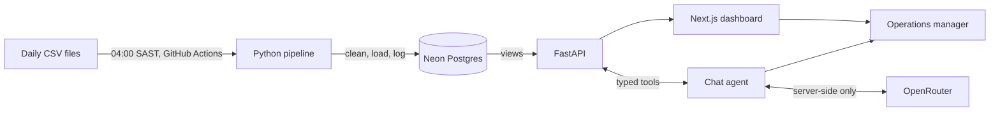

# Ridgeback Logistics: fleet data assessment

A daily pipeline, dashboard and chat assistant for Ridgeback's forklifts, reach trucks and pallet trucks.

| Item | Link |
| --- | --- |
| Live app | _Add after deployment_ |
| Walkthrough video | _Add after recording_ |
| Solution design diagram | [`docs/solution_design.png`](docs/solution_design.png), source [`docs/solution_design.drawio`](docs/solution_design.drawio) |

## Checklist

- [x] **Task 1.** Cleaning code in [`pipeline/clean.py`](pipeline/clean.py) and a [data model](docs/data_model.md)
- [x] **Task 2.** Ingestion pipeline in [`pipeline/`](pipeline/README.md), scheduled by [GitHub Actions](.github/workflows/ingest.yml)
- [ ] **Task 3.** Hosted dashboard and chat in [`app/`](app/README.md), and [`docs/chat_results.md`](docs/chat_results.md) with 5 test questions and the answers
- [x] **Task 4.** Solution design diagram in `docs/`, as the source file and a PNG
- [ ] No API keys in the repo or in front-end code
- [ ] The sections below are filled in

## Repo layout

```
data/
  incoming/          7 daily telemetry files, as delivered
  machine_list.csv   one row per machine
docs/                glossary, data model, diagram, chat results, model evaluation
pipeline/            cleaning rules, loader, SQL schema and views
app/api/             FastAPI: dashboard data and the chat agent
app/web/             Next.js: the dashboard and chat interface
```

## How it fits together



## How to run the pipeline

Create a Postgres database, and set `DATABASE_URL` in your environment. Then:

```bash
python -m venv .venv
.venv/Scripts/python -m pip install -r pipeline/requirements-dev.txt
.venv/Scripts/python pipeline/run.py
```

It loads each file in `data/incoming/` in date order, and running it again changes nothing. Add `--force` to reprocess every file with the same result. In production it's triggered by [`ingest.yml`](.github/workflows/ingest.yml) at 04:00 SAST, which can also be run by hand from the Actions tab. See the [pipeline README](pipeline/README.md) for behaviour, tests and troubleshooting.

## Model used and why

**`anthropic/claude-haiku-5.5`, falling back to `anthropic/claude-sonnet-5.5`, both through OpenRouter.**

I compared both on [14 fixed questions](docs/model_evaluation.md) with answers known from a separate profile of the raw files: figures, a tie, a required caveat, partial machine references, unanswerable questions, a prompt injection and an off-topic request. Accuracy came first, then cost and speed.

| Model | Passed | Avg tokens per question | Avg seconds per question | Price per million tokens, input / output |
| --- | --- | --- | --- | --- |
| Claude Haiku 5.5 | 14 of 14 | 5,455 | 12.7 | $0.10 / $0.50 |
| Claude Sonnet 5.5 | 14 of 14 | 5,408 | 14.7 | $2.00 / $10.00 |

The job is choosing the right tool and phrasing a short answer from its result, and the guard checks every figure afterwards. Haiku matched Sonnet on accuracy at a twentieth of the price, so it fits a USD 10 cap, and it was slightly faster in this run. Sonnet also sometimes added commentary nobody asked for, which is a risk in a data assistant. Sonnet stays as the fallback because availability matters more than cost during an outage. Prices are from OpenRouter's model list on 7 Nov 2026, and 14 questions is a small sample.

The guard earned its place during testing. Asked about `R88897`, Haiku correctly returned 8.11 and 13.87 hours, then added its own total of 22.98. The real total is 21.98. The guard rejected the figure, and the retry gave a clean answer.

## Data model

Tables, views and design decisions are in [`docs/data_model.md`](docs/data_model.md). The DDL is in [`pipeline/sql/`](pipeline/sql/).

## Assumptions

- **The week.** The week is Mon 7 to Sun 13 Sep 2026, and "this week" means the latest week in the data, not today's date.
- **File dates.** A file's date is its delivery date. Every figure uses the event's own date, so "Tuesday" means 8 Sep, which is in the file named `2026-09-09`.
- **Slash dates.** `10/09/2026` is day first, because that's the only reading inside the file's delivery window.
- **Late rows.** A row may be up to 7 days older than its delivery date. Anything older, or on or after the delivery date, is rejected.
- **Driver identity.** There's no driver ID, so a driver is their normalised full name. Two people with the same name would merge.
- **Blank drivers.** 19 impact, harsh and idle events have no driver, including 5 impacts. They stay unattributed and are shown as such, not assigned to whoever was logged on nearby.
- **Meter resets.** A RunHours drop of over 1 hour is a reset. `FBA33639374813` resets twice on 8 Sep. Daily hours are summed across the pieces, so time lost in the gap around a reset isn't counted.
- **Backward readings.** Smaller drops at shift changes are out-of-order readings, which the max-minus-min calculation absorbs.
- **Harsh events.** These are harsh braking, harsh acceleration and speeding. Impacts and excess idle are reported separately.
- **Countable events.** Update rows provide RunHours but are never counted as events.
- **Unknown machines.** `FBA37633406217` isn't on the machine list, so its 21 rows are held in `rejected_rows` and flagged. Adding it to the list and running with `--force` loads them.
- **Branch moves.** `R88897` is assigned to Northgate but reports from Riverside from 10 Sep. Branch figures use the reported branch, and the machine list keeps the assignment.
- **Truncated file.** The file delivered on 12 Sep ends in a cut-off row. Its good rows load and the file is marked `partial`. Hours for that day may read low, particularly for `R94267`.
- **Hours per driver.** Not offered, because rows at shift changes overlap and can't be attributed reliably. The chat says so.
- **Schedule.** GitHub Actions can start scheduled runs late and pauses them after long repo inactivity. That's acceptable for this assessment, and the [design](docs/solution_design.png) shows retries and alerts for production.
- **Authentication.** The brief asks for a public URL, so the app has no login. A real deployment would need one, because driver names are personal data.

## AI tools used

_To be confirmed before submitting._ Claude Code was used to plan the work, profile the data, write code and tests, and draft documentation. Every figure was checked against an independent calculation.

## What I would do next

- Add a login, with roles per branch, because the dashboard shows named drivers.
- Connect the pipeline to the real SFTP folder, archive raw files, and send alerts for late, failed and partial files.
- Move the rate limit to shared storage, because the current limit applies per server instance.
- Add a driver and machine lookup in the chat, so it can correct misspelt names.
- Add week-on-week comparison once more than one week of data exists.
- Add the Monday 07:00 weekly summary report (the stretch goal).
