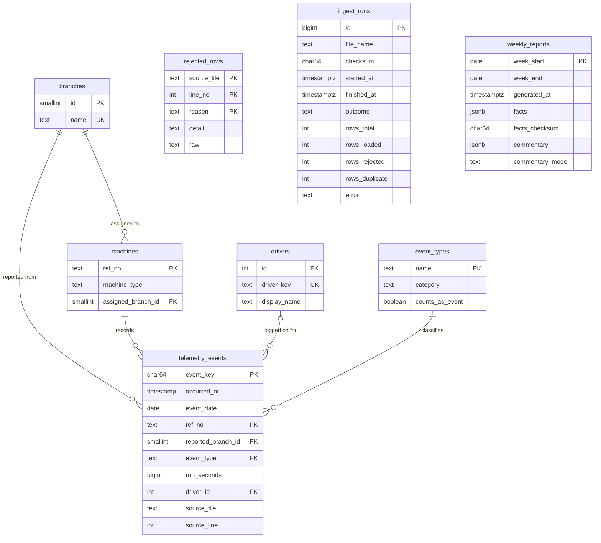

# Data model

The DDL is in [`pipeline/sql/`](../pipeline/sql/).

`rejected_rows` and `ingest_runs` link to files by name. They have no foreign keys on purpose, because they must be able to record bad data, such as a machine that isn't in `machines`.

`weekly_reports` stores each report's figures as they were when it was written, because a report is a record. Its `commentary` is empty if the LLM couldn't write text that passed the figure check.

## Reporting views

| View | One row per | Used for |
| --- | --- | --- |
| `v_machine_daily_hours` | Machine and day | Run hours, active machines, meter resets, branch moves |
| `v_driver_events` | Day, driver, machine and event type | Event counts per driver, machine or branch. Excludes routine updates |
| `v_branch_daily` | Branch and day | Hours, active machines, impacts, harsh events and idle events per branch |

## Design decisions

| Decision | Why |
| --- | --- |
| Primary key is a hash of the event's content | The same event gets the same key in any file, so loading twice can't create duplicates |
| Both assigned and reported branch are kept | The machine list and telemetry can disagree. `R88897` is assigned to Northgate but reported from Riverside from 10 Sep |
| `event_date` comes from the event's timestamp | A file's date is its delivery date, one day after its events, and some files hold older rows |
| Run hours are computed in a view, not stored | A corrected file or a changed rule takes effect with no backfill |
| Routine updates stay in `telemetry_events` | They aren't events, but their RunHours readings are valid. `event_types.counts_as_event` separates them |
| Driver can be null | Some events have no driver logged on. They're reported as unattributed, not guessed |
| Local `TIMESTAMP` rather than `TIMESTAMPTZ` | The files are in SAST, which has no daylight saving, and reports work in local days. `ingest_runs` uses `TIMESTAMPTZ` because it records system time |

## How new data fits

| Change | What's needed |
| --- | --- |
| New machine or branch | Add it to `machine_list.csv`. The next run syncs it |
| New driver | Nothing. Drivers are created as they appear |
| New event type | Add it to `event_types` and `EVENT_TYPES`. Until then, rows are held as `unknown_event_type`, and `--force` loads them afterwards |
